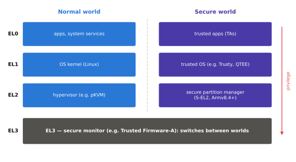
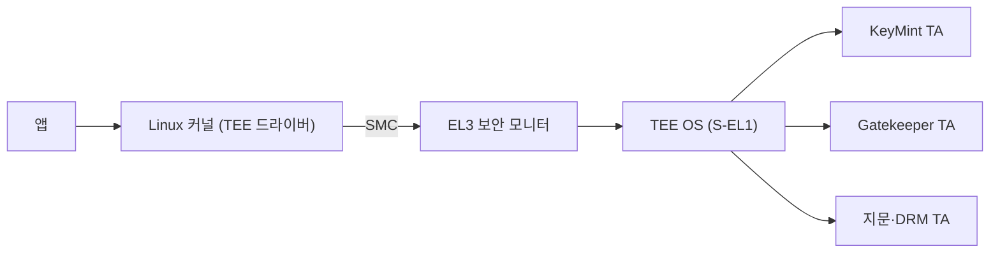

# TrustZone과 TEE

!!! spec "규격 · 세대"
    Arm **TrustZone**(Armv6 보안 확장에서 시작, Armv8-A의 EL3·Secure 상태) · **Secure EL2**(Armv8.4-A)와 **FF-A**(Firmware Framework for Arm A-profile) · GlobalPlatform TEE 규격(Client API·Internal Core API) · Android Keymaster → **KeyMint**(Android 12), Gatekeeper
    보안 세계 하나에 벤더 TEE OS → TEE OS 위의 여러 신뢰 앱(TA) → S-EL2 파티션 관리자로 보안 세계도 나누는 구조

!!! basic "한눈에 보기"
    **TrustZone**은 한 CPU를 **일반 세계(Normal World)**와 **보안 세계(Secure World)**로 나누는 Arm의 하드웨어 기능입니다. Android와 앱은 일반 세계에서, 지문 비교·키 보관 같은 민감한 일은 보안 세계에서 돌아갑니다.

    1. CPU는 매 순간 어느 세계에서 실행 중인지 표시하는 상태를 가집니다.
    2. 메모리와 장치에도 "보안 전용" 표시를 붙여, 일반 세계에서는 아예 보이지 않게 합니다.
    3. 두 세계 사이를 오가는 문은 **보안 모니터** 하나뿐입니다.

    은행 지점에 비유하면, 일반 세계는 손님이 다니는 객장이고 보안 세계는 금고실입니다. 같은 건물(같은 CPU)이지만 금고실 문은 정해진 직원(보안 모니터)만 열 수 있고, 손님은 창구로 요청만 할 수 있습니다.

## 예외 레벨과 두 세계 { .l2 }

| 레벨 | 일반 세계 | 보안 세계 |
|---|---|---|
| EL0 | 앱 | 신뢰 앱 (TA, Trusted Application) |
| EL1 | Linux 커널 | TEE OS (S-EL1) |
| EL2 | 하이퍼바이저 (pKVM·Gunyah 등) | 보안 파티션 관리자 (S-EL2, Armv8.4부터 선택) |
| EL3 | — | 보안 모니터 (TF-A BL31 등). 세계 전환 담당 |

일반 세계의 커널이 `SMC`(Secure Monitor Call) 명령을 실행하면 EL3로 넘어가고, 모니터가 레지스터 상태를 저장한 뒤 보안 세계로 전환합니다. 메모리 쪽에서는 버스 트랜잭션에 보안 여부(NS 비트)가 붙고, **TZASC**(TrustZone Address Space Controller) 같은 필터가 보안 영역 DRAM에 대한 일반 세계 접근을 막습니다. 주변장치도 보안 전용으로 지정할 수 있어, 지문 센서 입력이나 보안 화면 출력을 보안 세계만 다루게 할 수 있습니다.

## 주요 TEE 구현 { .l2 }

| TEE | 개발 주체 | 주로 쓰는 곳 |
|---|---|---|
| QSEE → QTEE | Qualcomm | Snapdragon |
| TEEGRIS | Samsung | Exynos 기반 Galaxy (이전 세대는 Kinibi) |
| Kinibi | Trustonic | 일부 Exynos·Dimensity 기기 |
| Trusty | Google (AOSP 공개) | Pixel 등 |
| OP-TEE | Linaro 중심 오픈소스 | 개발 보드, 임베디드·차량, 일부 상용 기기 |
| Microtrust 등 | 중국 TEE 벤더 | 일부 Dimensity 기기 |

Android 프레임워크는 TEE 종류와 상관없이 같은 HAL을 봅니다. **KeyMint**는 키 생성·서명·암호화와 키 증명(attestation)을, **Gatekeeper**는 PIN·패턴·비밀번호 검증과 실패 횟수에 따른 대기 시간 강제를 맡습니다. 키 자체는 TEE 밖으로 나가지 않고, 일반 세계는 TEE가 암호화해 준 "키 블롭"만 보관합니다.

??? expert "전문가 노트 — TEE의 공격 표면, S-EL2와 FF-A, 사용자 인증과 키의 결합"
    **TEE의 공격 표면.** TrustZone 격리는 강력하지만, 보안 세계도 결국 같은 CPU·캐시·DRAM을 씁니다. TEE OS와 TA의 메모리 손상 버그가 공개적으로 여러 차례 보고되었고, 특정 TA 하나의 취약점이 TEE 전체 권한으로 이어진 사례도 있습니다. 같은 이유로 캐시 타이밍 같은 부채널에도 노출됩니다. Android가 가장 중요한 키에는 별도 보안 칩의 **StrongBox**를 선택할 수 있게 한 배경입니다([하드웨어 보안 모듈](secure-element.md)).

    **S-EL2와 FF-A.** 예전에는 보안 세계 안의 모든 코드가 S-EL1의 TEE OS 하나를 공유했습니다. Armv8.4의 Secure EL2를 쓰면 보안 세계에도 하이퍼바이저(보안 파티션 관리자, 예: Hafnium)를 두어 벤더 TEE, DRM, 펌웨어 서비스를 서로 다른 파티션으로 나눌 수 있습니다. 파티션과 일반 세계의 메시지·메모리 공유 방식은 Arm FF-A 규격으로 표준화되어, 벤더별 SMC 인터페이스가 줄어드는 방향입니다.

    **사용자 인증과 키 결합.** KeyMint 키는 "최근 N초 안에 사용자 인증이 있었을 때만 사용" 같은 조건을 가질 수 있습니다. Gatekeeper나 지문 TA가 인증에 성공하면 HMAC으로 서명된 인증 토큰을 만들고, KeyMint는 같은 공유 키로 토큰을 확인합니다. 두 TA가 공유 키를 부팅마다 협상하므로, 일반 세계가 토큰을 위조할 수 없습니다.

    **무차별 대입 지연.** 6자리 PIN은 경우의 수가 \(10^6\)입니다. 시도마다 키 유도에 80 ms가 걸린다고 가정하면, 대기 시간 없이도 전부 시도하는 데 약 22.2시간이면 됩니다. 그래서 키 유도 비용만으로는 부족하고, Gatekeeper·보안 칩이 실패 횟수를 변조 불가능하게 저장하고 실패가 쌓일수록 대기 시간을 늘리는 **하드웨어 기반 제한**이 핵심입니다. (가정값이며, 수치는 `tools/soc_numbers.py`에서 계산)

## 칩셋 비교

| 항목 | Snapdragon | Exynos | Dimensity | Tensor | Apple |
|---|---|---|---|---|---|
| TEE OS | QTEE | TEEGRIS (이전 Kinibi) | 기기·세대별 선택 | Trusty | TrustZone 대신 Secure Enclave 중심 |
| EL3 펌웨어 | 벤더 펌웨어 | 벤더 펌웨어 | TF-A 기반 | 벤더 펌웨어 | 비공개 |
| 소스 공개 | 비공개 | 비공개 | 비공개 (TF-A 일부 공개) | Trusty는 AOSP 공개 | 비공개 |

> 세대별 보안 기능 도입 시점은 [칩셋 세대 인덱스](../reference/chipset-index.md)에 모읍니다.

## 관련 페이지
- [부팅 과정](boot.md) — 보안 모니터와 TEE가 적재되는 순서
- [하드웨어 보안 모듈](secure-element.md) — TEE보다 한 단계 더 격리된 보안 칩
- [가상화](virtualization.md) — EL2 하이퍼바이저와 보호 VM
- [메모리 보호와 IOMMU](../memory/iommu.md) — 장치의 보안 메모리 접근 차단
- [Arm 아키텍처](../cpu/arm-architecture.md) — 예외 레벨과 아키텍처 버전
