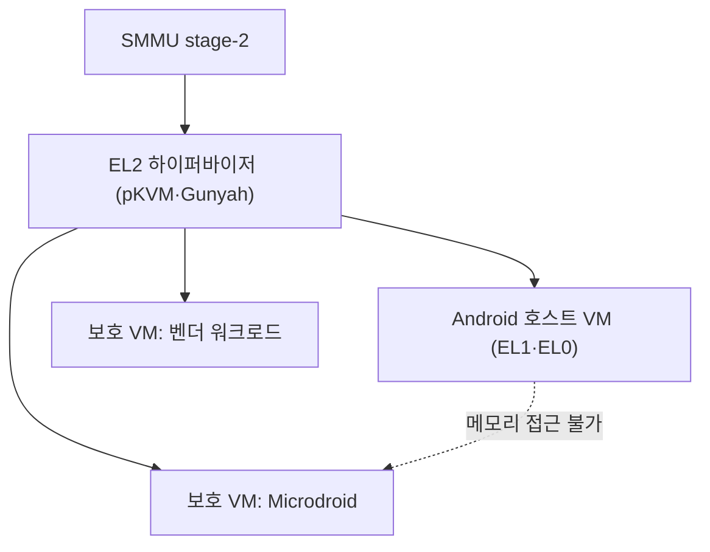

# 가상화

!!! spec "규격 · 세대"
    Armv8-A **EL2**와 2단계 주소 변환(stage-2) · **VHE**(Virtualization Host Extensions, Armv8.1) · GICv3·v4 가상 인터럽트 · SMMU stage-2 · Arm **CCA**(RME, Armv9.2) · Android Virtualization Framework(**AVF**, Android 13) · pKVM · Qualcomm **Gunyah**(오픈소스 공개)
    벤더 하이퍼바이저가 커널 보호용으로만 쓰던 EL2 → Android가 표준 하이퍼바이저(pKVM)와 보호 VM을 제공 → 기밀 연산(Realm)으로 확장 논의

!!! basic "한눈에 보기"
    **가상화**는 한 칩 위에서 여러 운영체제를 서로 모르게 나눠 돌리는 기술입니다. 서버에서는 오래된 기술이지만, 스마트폰에서는 최근 **보안 격리**의 수단으로 중요해졌습니다.

    1. **하이퍼바이저** — 커널보다 한 단계 높은 권한(EL2)에서 메모리와 장치를 나눠 줍니다.
    2. **보호 VM** — Android 커널조차 그 안의 메모리를 볼 수 없는 작은 가상 머신입니다.
    3. **쓰임새** — 생체 인증 처리, 기기 증명, 머신러닝 모델 보호처럼 Android에서 떼어 놓고 싶은 일을 맡깁니다.

    아파트 관리사무소(하이퍼바이저)가 세대별 열쇠를 나눠 주는 것과 비슷합니다. 한 세대(Android)가 문제를 일으켜도 옆 세대(보호 VM)의 문은 열 수 없습니다.

## 스마트폰 하이퍼바이저 { .l2 }

| 하이퍼바이저 | 개발 주체 | 특징 |
|---|---|---|
| pKVM (protected KVM) | Google (Linux KVM 기반, 업스트림) | 호스트 Android 커널을 신뢰하지 않는 구조. EL2에 작은 코드만 두고 메모리 소유권을 추적 |
| Gunyah | Qualcomm (오픈소스 공개) | Snapdragon의 EL2 하이퍼바이저. 이전 세대의 비공개 벤더 하이퍼바이저(QHEE로 알려짐)를 대체한 것으로 알려짐 |
| GenieZone | MediaTek | Dimensity의 하이퍼바이저 (공개 정보 제한) |
| 벤더 커널 보호 하이퍼바이저 | Samsung 등 | 커널 코드·페이지 테이블 무결성 감시 (예: Samsung RKP) |

## AVF와 보호 VM { .l2 }

| 요소 | 역할 |
|---|---|
| AVF | 보호 VM을 만들고 관리하는 Android 시스템 기능 |
| crosvm | 호스트 쪽 VM 모니터 (Rust 구현) |
| Microdroid | 보호 VM 안에서 도는 최소화된 Android 기반 OS |
| pvmfw | 보호 VM의 첫 펌웨어. VM 이미지 검증과 비밀 전달 |
| DICE | 부팅 단계마다 측정값을 누적해 VM의 신원을 만드는 체계 |

보호 VM에 할당된 메모리는 하이퍼바이저가 stage-2 변환에서 호스트 매핑을 지우고, SMMU 설정으로 DMA 장치도 접근하지 못하게 합니다. 그래서 호스트 커널이 완전히 장악되어도 보호 VM의 메모리는 읽을 수 없습니다. 이는 TrustZone과 달리 **EL3·보안 세계에 코드를 더하지 않고** 격리 영역을 늘린다는 점에서 의미가 큽니다.

??? expert "전문가 노트 — TEE와 보호 VM의 분담, 성능 비용, CCA Realm, 신뢰 경계 설계"
    **TEE와 보호 VM의 분담.** TrustZone TA는 벤더가 서명해야 하고 보안 세계 전체가 하나의 신뢰 경계를 공유합니다. 보호 VM은 Android 쪽에서 표준 방식으로 만들 수 있고, VM 사이도 서로 격리됩니다. 그래서 키 저장·부팅처럼 가장 작은 신뢰 기반은 TEE·보안 칩에 두고, 더 크고 자주 바뀌는 보안 코드(예: 원격 키 프로비저닝 처리, 보호가 필요한 ML 추론)를 보호 VM으로 옮기는 방향입니다([TrustZone과 TEE](trustzone.md)).

    **성능 비용.** EL2 하이퍼바이저가 켜지면 호스트도 stage-2 변환을 거치므로 TLB 미스 비용이 늘고, 인터럽트·장치 접근 일부에 트랩이 생깁니다. pKVM은 호스트 메모리를 큰 블록 매핑으로 두고 하이퍼바이저 코드를 최소화해 비용을 줄입니다. 벤더 문서와 발표는 대부분의 워크로드에서 차이가 작다고 설명하지만, 메모리 집약 작업에서는 측정으로 확인하는 것이 좋습니다.

    **CCA Realm.** Armv9.2의 RME는 세계를 Normal·Secure·Realm·Root 네 개로 늘리고, **GPT**(Granule Protection Table)로 물리 메모리 페이지마다 어느 세계 소유인지 하드웨어가 검사하게 합니다. Realm 관리는 RMM(Realm Management Monitor)이 맡고, 호스트 하이퍼바이저는 Realm의 자원을 할당하지만 내용은 볼 수 없습니다. 서버용으로 먼저 설계되었으며, 이 페이지 기준 시점에 스마트폰 SoC에서 CCA를 널리 쓴다는 공개 정보는 제한적입니다.

    **신뢰 경계 설계.** 하이퍼바이저가 보안을 지키려면 모든 DMA 마스터가 SMMU 아래에 있어야 하고, 하이퍼바이저 이전 부팅 단계가 검증되어 있어야 하며, 하이퍼바이저 자체 코드가 작아야 합니다. 하나라도 빠지면 격리가 무너집니다. 예를 들어 SMMU를 우회하는 장치가 하나 있으면 그 장치의 펌웨어를 장악한 공격자가 보호 VM 메모리를 읽을 수 있습니다([메모리 보호와 IOMMU](../memory/iommu.md)).

## 칩셋 비교

| 항목 | Snapdragon | Exynos | Dimensity | Tensor | Apple |
|---|---|---|---|---|---|
| EL2 하이퍼바이저 | Gunyah | 벤더 하이퍼바이저 | GenieZone | pKVM | 비공개 (일부 기능은 자체 보호 계층으로 알려짐) |
| AVF 보호 VM | 기기·세대별 | 기기·세대별 | 기기·세대별 | Pixel에서 지원 | 해당 없음 |
| 소스 공개 | Gunyah 공개 | 비공개 | 비공개 | pKVM 업스트림 | 비공개 |

> 세대별 지원 여부는 [칩셋 세대 인덱스](../reference/chipset-index.md)에 모읍니다.

## 관련 페이지
- [TrustZone과 TEE](trustzone.md) — 보안 세계와 보호 VM의 차이
- [메모리 보호와 IOMMU](../memory/iommu.md) — stage-2 변환과 SMMU
- [하드웨어 공격과 대응](attacks.md) — CCA와 메모리 격리
- [Linux 커널과 SoC 지원](../software/linux-kernel.md) — KVM과 업스트림 지원
