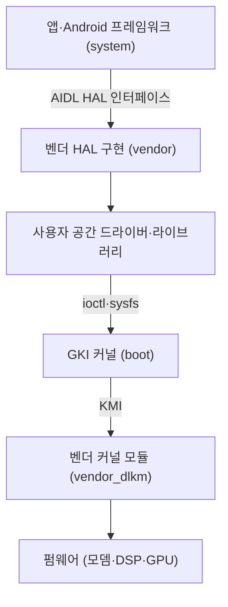

# Android BSP 구조

!!! spec "규격 · 세대"
    **Project Treble**(Android 8.0, 2017): vendor 인터페이스 분리, HIDL·VINTF·VNDK 도입 → **동적 파티션**(Android 10) → **GKI**(Generic Kernel Image, Android 11의 5.4 커널에서 시작, Android 12의 5.10 커널부터 GKI 2.0으로 본격화) → **Stable AIDL HAL**(Android 11 도입, 이후 HIDL을 대체하며 신규 HAL의 기본 방식)
    vendor 이미지 재사용 정책: GRF(Google Requirements Freeze, Android 12 무렵부터)로 SoC vendor 구현을 여러 Android 버전에 걸쳐 재사용할 수 있게 함. 세부 기한은 Google 정책 문서 기준이며 버전마다 바뀝니다.

!!! basic "한눈에 보기"
    **BSP(Board Support Package)**는 특정 칩과 보드에서 운영체제가 돌아가도록 하는 소프트웨어 묶음입니다. 부트로더, 커널 드라이버, 펌웨어, HAL, 각종 설정 파일이 여기에 들어갑니다.

    1. **SoC 벤더**(Qualcomm·MediaTek·Samsung LSI 등)가 칩에 맞는 BSP를 만듭니다.
    2. **OEM**(스마트폰 제조사)이 이를 받아 자기 기기의 카메라 센서·디스플레이·배터리에 맞게 고치고 UI를 얹습니다.
    3. **Google**은 Android 본체와 호환성 테스트로 "이 규격을 지키면 Android 기기로 인정한다"는 기준을 줍니다.

    예전에는 Android 새 버전이 나오면 이 세 주체가 전부 다시 맞춰야 해서 업데이트가 느렸습니다. Treble은 집의 **벽 안 배관(vendor)**과 **가구(Android system)**를 표준 규격의 콘센트로 분리해, 가구를 바꿀 때 벽을 뜯지 않아도 되게 만든 개편입니다.

## 파티션과 계층 { .l2 }

| 영역 | 주인 | 내용 |
|---|---|---|
| `system`, `system_ext`, `product` | Google + OEM | Android 프레임워크, 시스템 앱, OEM 공통 기능 |
| `vendor` | SoC 벤더 + OEM | HAL 구현, 벤더 라이브러리, GPU 사용자 모드 드라이버, 펌웨어 일부 |
| `odm` | ODM·OEM | 같은 SoC를 쓰는 기기별 차이(센서·보드 설정) |
| `boot`, `init_boot`, `vendor_boot` | Google(GKI) / 벤더 | GKI 커널, 램디스크, 벤더 램디스크와 디바이스 트리 |
| `vendor_dlkm`, `odm_dlkm` | SoC 벤더 / ODM | 벤더 커널 모듈(`.ko`) |
| 펌웨어 파티션 | SoC 벤더 | 모뎀·DSP·GPU·부트로더·TrustZone 이미지 |

경계마다 **안정된 인터페이스**가 있다는 점이 핵심입니다. 프레임워크와 HAL 사이에는 버전이 붙은 AIDL 인터페이스, 커널과 벤더 모듈 사이에는 **KMI(Kernel Module Interface)**가 있습니다. 경계가 고정되어 있으면 한쪽만 바꿔도 다른 쪽이 그대로 동작합니다. 디바이스가 어떤 HAL 버전을 제공하는지는 VINTF 매니페스트로 선언하고, 호환성은 VTS로 검사합니다.

## GKI와 벤더 모듈 { .l2 }

| 항목 | GKI 이전 | GKI 이후 |
|---|---|---|
| 커널 소스 | Linux LTS → Android 공통 커널 → SoC 벤더 커널 → OEM 커널 (각 단계마다 수정) | Google이 빌드한 **공통 커널 바이너리** 하나 |
| SoC 전용 코드 | 커널 본체에 직접 패치 | 로드 가능한 **벤더 모듈**로 분리 |
| 보안 패치 | 단계마다 다시 병합해야 해 느림 | 공통 커널을 갱신하면 여러 기기에 적용 쉬움 |
| 벤더 훅 | 내부 함수 직접 수정 | 정해진 vendor hook·tracepoint로만 개입 |

GKI의 효과는 커널 **파편화**를 줄이는 데 있습니다. 예전에는 같은 LTS 버전이라도 기기마다 수만 줄의 비공개 패치가 쌓여 있어, 보안 패치 하나를 반영하는 데도 여러 단계를 거쳐야 했습니다. 지금은 SoC 전용 드라이버를 모듈로 빼고, 모듈이 쓸 수 있는 커널 심볼 목록(KMI 심볼 리스트)을 고정합니다.

## BSP 릴리스와 업데이트 주기 { .l2 }

| 단계 | 하는 일 |
|---|---|
| 1. SoC 벤더 BSP | 칩 발표 전후로 OEM에 BSP 배포. 공개 부분은 Qualcomm은 CodeLinaro(이전 CodeAurora), MediaTek·Samsung은 OEM을 통해 커널 소스 공개 |
| 2. OEM 통합 | 보드 디바이스 트리, 카메라 튜닝, 디스플레이 패널, 충전 정책, UI |
| 3. 인증 | CTS·VTS 등 Google 호환성 테스트, 통신사 인증 |
| 4. 유지보수 | 월간 보안 패치, Android 버전 업그레이드 |

업데이트 기간은 SoC 벤더가 BSP를 몇 년간 유지하느냐에 크게 좌우됩니다. 발표 기준으로 Google Pixel 8 시리즈와 Samsung Galaxy S24 시리즈는 7년 업데이트를 약속했고, Qualcomm은 Snapdragon 8 Elite 세대부터 Google과 함께 최대 8년간 OS·보안 업데이트를 지원할 수 있게 하겠다고 발표했습니다. 실제 기간은 기기별 OEM 정책으로 정해집니다.

??? expert "전문가 노트 — KMI 심볼 리스트, vendor freeze의 의미, 벤더 패치의 현실"
    **KMI 심볼 리스트.** GKI 브랜치(예: `android14-6.1`)는 출시 후 KMI를 고정합니다. 벤더는 자신이 쓰는 커널 심볼을 심볼 리스트로 제출하고, Google은 ABI 모니터링 도구로 그 심볼의 타입·레이아웃이 바뀌지 않는지 검사합니다. 구조체에 필드를 추가해야 할 때를 대비해 `ANDROID_KABI_RESERVE` 같은 예약 패딩을 미리 넣어 둡니다. 벤더 모듈이 공통 커널의 동작을 바꾸고 싶으면 정해진 vendor hook(`trace_android_vh_*`, `trace_android_rvh_*`)에 콜백을 등록해야 하며, 스케줄러 튜닝처럼 벤더가 손대고 싶어 하는 영역에 이런 훅이 집중됩니다.

    **vendor freeze의 의미.** GRF 정책 아래에서는 Android 새 버전으로 업그레이드할 때 SoC 벤더가 vendor 구현을 새로 내지 않아도, 이전 vendor 이미지가 새 system과 함께 동작하도록 요구합니다. 덕분에 OEM은 SoC 벤더의 새 BSP를 기다리지 않고 OS 업그레이드를 할 수 있습니다. 반대로 새 Android 기능이 새 HAL 버전을 필요로 하면, 그 기능은 오래된 vendor 이미지에서 선택 사항이 됩니다.

    **벤더 패치의 현실.** GKI 이후에도 SoC 벤더 커널 모듈은 수백 개 단위로 존재하며, GPU·카메라·모뎀 드라이버는 상당 부분 비공개 사용자 공간 라이브러리와 펌웨어에 의존합니다. 커널 모듈은 GPL 소스 공개 대상이지만 그 위의 HAL과 펌웨어는 그렇지 않아, 오픈소스 커스텀 ROM이 최신 Android를 올릴 때 가장 큰 장벽이 됩니다. Pixel처럼 OEM이 SoC 설계에 관여하는 경우에도 모뎀·GPU 부분은 IP 공급사의 바이너리에 의존합니다.

    **파티션 크기와 OTA.** 동적 파티션(`super`)은 논리 파티션 크기를 OTA 때 조정할 수 있게 하고, Virtual A/B는 스냅샷으로 업데이트 중에도 사용할 수 있게 합니다. BSP 관점에서는 `vendor`·`vendor_dlkm`이 독립적으로 업데이트될 수 있도록 파티션 경계와 모듈 의존성을 설계해야 합니다.

## 칩셋 비교

| 항목 | Qualcomm Snapdragon | MediaTek Dimensity | Samsung Exynos | Google Tensor | Apple |
|---|---|---|---|---|---|
| BSP 주체 | SoC 벤더 → 다수 OEM | SoC 벤더 → 다수 OEM | Samsung LSI → 주로 Samsung MX | Google이 기기와 BSP 함께 관리 | 칩·OS·기기 수직 통합 |
| 공개 커널 소스 | CodeLinaro 등 공개 저장소 | OEM 커널 소스 공개 중심 | OEM 커널 소스 공개 | AOSP 커널 저장소 | XNU 커널 소스는 공개, 칩 드라이버 대부분은 비공개 |
| 장기 지원 | 발표 기준 플래그십 최대 8년 지원 프로그램 | OEM 정책 중심 | Galaxy 플래그십 정책에 연동 | Pixel 8부터 7년 | 기기 정책 (공식 기간 비공개) |

## 관련 페이지
- [Linux 커널과 SoC 지원](linux-kernel.md) — 벤더 모듈이 쓰는 커널 프레임워크
- [부팅 과정](../security/boot.md) — `boot`·`vendor_boot` 이미지가 실행되는 순서
- [그래픽 API와 드라이버](../gpu/apis.md) — 사용자 모드·커널 모드 GPU 드라이버의 분리
- [AI 소프트웨어 스택](../npu/software.md) — NPU 드라이버와 런타임의 배포 방식
- [주요 제조사와 생태계](../getting-started/ecosystem.md) — SoC 벤더와 OEM의 관계
