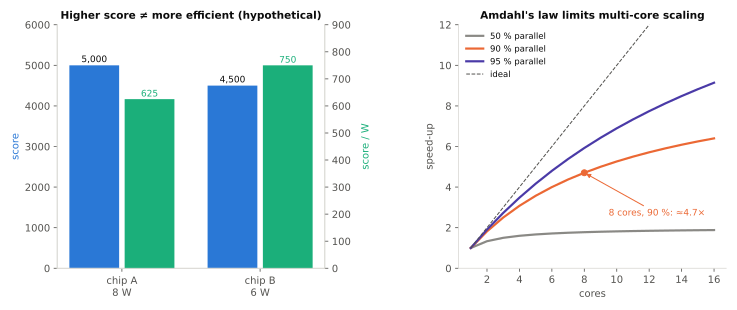
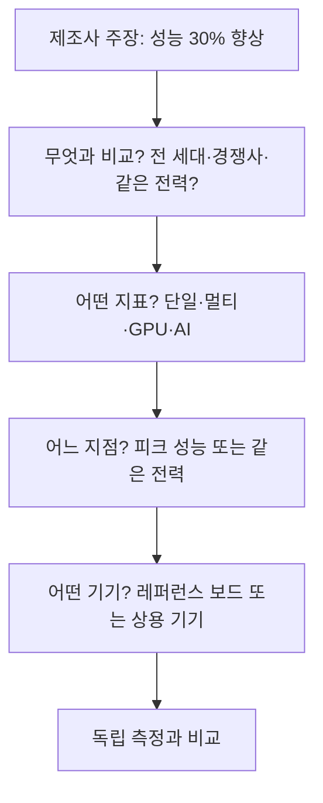

# 벤치마크 읽는 법

!!! spec "규격 · 세대"
    CPU: **Geekbench 6**(Primate Labs, 2023; 단일·멀티 코어) · **SPEC CPU 2017**(SPEC; 리뷰어가 모바일 코어 분석에 사용) · GPU: **3DMark**(UL; Wild Life·Wild Life Extreme, 레이 트레이싱 Solar Bay, Steel Nomad Light, 스트레스 테스트) · **GFXBench**(Kishonti) · AI: **MLPerf Mobile**(MLCommons) · 종합: **AnTuTu**
    점수 비교는 같은 벤치마크의 **같은 메이저 버전** 안에서만 의미가 있습니다. 버전이 바뀌면 작업 구성과 기준값이 바뀌어 점수 척도가 달라집니다.

!!! basic "한눈에 보기"
    벤치마크는 "정해진 일을 얼마나 빨리 하는가"를 점수로 바꾼 것입니다. 점수 하나는 편하지만, 그 뒤에 숨은 조건을 모르면 잘못 읽기 쉽습니다.

    1. **무엇을 재나** — CPU 한 코어인지, 모든 코어인지, GPU인지, 저장장치까지 섞은 종합인지.
    2. **얼마나 오래 재나** — 몇 초짜리 순간 성능인지, 20분 동안 반복하는 지속 성능인지.
    3. **얼마나 썼나** — 같은 점수를 몇 와트로 냈는지. 배터리와 발열은 여기서 갈립니다.

    달리기에 비유하면 단일 코어 점수는 100 m 기록, 멀티 코어 점수는 계주 기록, 지속 성능 테스트는 마라톤 기록입니다. 100 m가 빠른 선수가 마라톤도 빠르다는 보장은 없습니다.

## 주요 벤치마크와 재는 것 { .l2 }

| 벤치마크 | 대상 | 측정 시간 | 읽을 때 주의할 점 |
|---|---|---|---|
| Geekbench 6 단일 코어 | 가장 빠른 CPU 코어 1개 | 짧음 | 앱 반응 속도와 관련 깊음. 짧아서 열 영향 작음 |
| Geekbench 6 멀티 코어 | 모든 코어 협업 | 짧음 | 6부터 작업을 나눠 협업하는 방식이라 코어 수에 선형 비례하지 않음 |
| SPEC CPU 2017 (int·fp) | CPU 코어·메모리 계층 | 김 | 컴파일러·플래그에 따라 달라짐. 공식 결과가 아닌 리뷰어 측정이 대부분 |
| 3DMark Wild Life Extreme 등 | GPU 오프스크린 렌더링 | 1분 안팎 | 해상도 고정 오프스크린이라 화면 해상도와 무관 |
| 3DMark 스트레스 테스트 | GPU 지속 성능 | 약 20분 반복 | 최고·최저 루프 점수와 **안정성(%)** 함께 표시 |
| GFXBench | GPU (onscreen·offscreen) | 짧음·긴 반복 | onscreen은 화면 해상도·vsync 영향 받음 |
| MLPerf Mobile | NPU·AI 가속기 | 작업별 | 모델·정밀도·지연 기준을 함께 봐야 함 |
| AnTuTu | CPU·GPU·메모리·UX 종합 | 수 분 | 항목 가중치가 버전마다 바뀌고 저장장치·메모리 영향도 섞임 |

## 지속 성능과 전력 대비 성능 { .l2 }

짧은 벤치마크는 기기가 차가운 상태에서 최고 클럭으로 끝나 버리지만, 게임은 수십 분 이어집니다. 스트레스 테스트의 **안정성**은 최저 루프 점수 ÷ 최고 루프 점수입니다. 가상의 예로 최고 5,000점, 최저 3,200점이면 안정성은 64%입니다.

전력 대비 성능은 점수 ÷ 평균 전력으로 봅니다. 가상의 칩 A가 8 W로 5,000점, 칩 B가 6 W로 4,500점이라면 점수는 A가 높지만, 와트당 점수는 A가 625, B가 750으로 B가 1.2배 효율적입니다. 기기 방열 한계가 6 W라면 장시간 사용에서는 B가 더 빠를 수도 있습니다([열 관리와 스로틀링](../power/thermal.md)). (가정값이며, 수치는 `tools/soc_numbers.py`에서 계산)

멀티 코어 점수가 코어 수만큼 늘지 않는 것은 병렬화되지 않는 부분 때문이기도 합니다. Amdahl의 법칙으로 작업의 90%가 병렬화된다고 가정하면 코어 8개의 이론 속도 향상은 약 4.7배에 그칩니다. (수치는 `tools/soc_numbers.py`에서 계산)

??? expert "전문가 노트 — 점수 합산 방식, 벤치마크 감지의 역사, 전력 곡선 읽기, 측정 위생"
    **점수 합산 방식.** Geekbench 같은 벤치마크는 하위 작업 점수를 산술 평균이 아니라 **기하 평균**으로 합칩니다. 기하 평균은 어느 한 작업이 아주 빠른 칩이 전체 점수를 독점하지 못하게 하지만, 대신 특정 작업에 강한 가속기(암호·행렬 연산)가 들어가면 그 작업 하나로 총점이 눈에 띄게 오릅니다. 가상의 하위 점수 2와 8이 있으면 산술 평균은 5, 기하 평균은 4입니다. (수치는 `tools/soc_numbers.py`에서 계산) 새 버전에서 작업 구성이 바뀌면 같은 칩의 상대 순위도 바뀔 수 있으므로, 점수와 함께 버전을 적어야 합니다.

    **벤치마크 감지의 역사.** 벤치마크 앱 이름을 감지해 평소보다 높은 클럭·온도 한계를 허용하는 사례가 여러 번 드러났습니다. 2013년 AnandTech 등이 일부 Galaxy 기기의 벤치마크 전용 GPU 클럭 동작을 보도했고, 2018년 UL은 벤치마크 감지를 이유로 일부 Huawei 기기를 3DMark 순위에서 제외했습니다. 2021년에는 OnePlus 기기의 앱별 성능 제한이, 2022년에는 Samsung의 GOS(Game Optimizing Service) 문제가 알려져 Geekbench가 해당 기기를 목록에서 제외했습니다. 리뷰어들은 이후 벤치마크 앱 이름을 바꾼 "위장 빌드"로 같은 동작을 하는지 확인하는 방법을 씁니다.

    **전력 곡선 읽기.** 칩 발표 자료의 "같은 성능에서 전력 X% 감소"와 "같은 전력에서 성능 Y% 향상"은 전력-성능 곡선의 서로 다른 지점입니다. 곡선 아래쪽(저전력)에서의 이득은 크게 나오고, 피크에서의 이득은 작게 나오는 경우가 많습니다. 공정 미세화 효과와 아키텍처 효과도 섞여 있으므로, 독립 측정에서는 여러 주파수 단계의 전력과 점수를 재 곡선 전체를 비교합니다([성능·전력·면적 (PPA)](../basics/ppa.md)).

    **측정 위생.** 같은 기기라도 시작 온도, 배터리 잔량, 충전 중 여부, 화면 밝기, 백그라운드 작업, 성능 모드 설정에 따라 결과가 달라집니다. 신뢰할 만한 측정은 기기를 일정 온도로 식힌 뒤 같은 조건으로 여러 번 돌려 중앙값과 편차를 적습니다. 전력은 배터리 쪽 측정인지 SoC 레일 측정인지에 따라 화면·DRAM 포함 여부가 다르므로 함께 밝혀야 합니다([전력 측정과 분석](../power/measurement.md)).

## 칩셋 비교

벤치마크 점수 자체는 측정 조건 없이 비교하지 않습니다. 대신 제조사별로 **주장을 내는 방식**을 비교합니다.

| 항목 | Qualcomm | MediaTek | Samsung Exynos | Google Tensor | Apple |
|---|---|---|---|---|---|
| 발표 비교 기준 | 전 세대 대비 %, 경쟁 칩과 그래프 비교 | 전 세대 대비 %, 경쟁 칩 비교 | 전 세대 대비 % | 점수보다 AI·카메라 기능 중심 | 전 세대·경쟁 칩 대비 %, 같은 전력 비교 그래프 |
| 측정 기기 | 레퍼런스 기기 결과가 함께 공개되는 경우가 많음 | 레퍼런스 기기 | 상용 기기 | 상용 기기 | 자사 기기 |
| 읽을 때 확인할 것 | 레퍼런스 기기와 상용 기기의 방열 차이 | 같은 칩이라도 OEM별 튜닝 차이 | 같은 기기 모델의 지역별 칩 차이 | 지속 성능 | 비교 대상과 전력 지점 |

## 관련 페이지
- [열 관리와 스로틀링](../power/thermal.md) — 순간 성능과 지속 성능의 차이
- [전력 측정과 분석](../power/measurement.md) — 와트당 성능을 재는 방법
- [성능·전력·면적 (PPA)](../basics/ppa.md) — 전력-성능 곡선과 비교 지점
- [TOPS와 정밀도](../npu/tops.md) — AI 성능 수치를 읽는 법
- [성능 분석 도구](profiling.md) — 점수 차이의 원인을 찾는 도구
