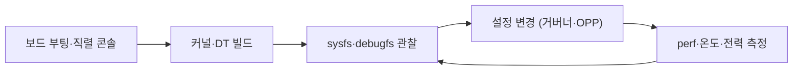

# 개발 보드로 실습

!!! spec "규격 · 세대"
    **96Boards**(Linaro가 정한 보드 폼팩터·확장 커넥터 규격, Consumer·Enterprise 에디션 등) · 상용 SBC(단일 보드 컴퓨터)는 독자 폼팩터가 대부분
    실습 대상 커널 인터페이스: sysfs `cpufreq`·`cpuidle`·`thermal`·`devfreq` · debugfs `clk`·`regulator`·`interconnect` · `perf` · 디바이스 트리 오버레이(부트로더·배포판에 따라 지원 방식 다름)

!!! basic "한눈에 보기"
    스마트폰은 잠겨 있어 커널 설정이나 클럭을 직접 들여다보기 어렵습니다. **개발 보드**는 스마트폰과 같은 계열의 Arm SoC를 올린 기판으로, 직렬 콘솔과 루트 권한을 주기 때문에 이 책에서 다룬 내용을 직접 확인할 수 있습니다.

    1. **보드를 고릅니다** — 메인라인 Linux가 잘 돌아가는지, 자료와 커뮤니티가 많은지가 가장 중요합니다.
    2. **커널을 직접 빌드합니다** — 디바이스 트리를 고치고 다시 부팅해 보는 것만으로도 SoC 구조가 손에 잡힙니다.
    3. **측정합니다** — 주파수·온도·성능 카운터를 바꿔 가며 숫자가 어떻게 움직이는지 봅니다.

    운전면허를 딸 때 도로 연습 전에 연습장에서 기어와 브레이크를 마음껏 만져 보는 것과 같습니다.

## 보드 선택 { .l2 }

| 계열 | 예시 보드 | SoC 특징 | 실습 관점 장점 |
|---|---|---|---|
| Qualcomm 로보틱스·IoT | RB3 Gen 2, RB5, RUBIK Pi 3 | QCS·QRB 계열(스마트폰 SoC와 같은 계보) | Adreno·Hexagon 포함 실제 Snapdragon 구조, Linaro·Qualcomm의 업스트림 지원 |
| 96Boards 계열 | DragonBoard 410c, RB3(DragonBoard 845c), HiKey 960 | Snapdragon·Kirin 기반(구세대) | 규격 커넥터, AOSP·메인라인 레퍼런스로 오래 쓰임 |
| Raspberry Pi 5 | Raspberry Pi 5 | Broadcom BCM2712, Cortex-A76 4코어, 주변장치는 PCIe로 연결된 RP1 칩 | 자료·커뮤니티 최대, 커널 빌드·디바이스 트리 오버레이 입문에 적합 |
| Rockchip RK3588 | Radxa ROCK 5B, Orange Pi 5 등 | Cortex-A76 4 + A55 4 이기종 구성, Mali GPU, NPU | big.LITTLE·EAS 실습, 메인라인 지원이 빠르게 진행 |
| MediaTek Genio | Genio 1200·700·510 EVK | IoT용 MediaTek SoC | MediaTek 계열 BSP·Yocto 실습 |
| NXP i.MX | i.MX 8M Plus, i.MX 93·95 EVK | 산업·차량용, 장기 공급 | 메인라인 지원이 충실, 문서 공개 범위가 넓음 |

Raspberry Pi 5는 모든 코어가 같은 종류라 이기종 스케줄링 실습에는 맞지 않지만, 자료가 가장 많아 커널 빌드와 디바이스 트리 입문에 가장 무난합니다. 라즈베리 파이 5 자체의 하드웨어와 활용은 저자의 라즈베리 파이 5 책과 함께 보면 좋습니다. 이기종 클러스터와 EAS를 보려면 RK3588 보드나 Qualcomm 보드가 적합합니다.

## 실습 목록 { .l2 }

| 번호 | 실습 | 확인할 것 | 관련 페이지 |
|---|---|---|---|
| 1 | 커널과 디바이스 트리 빌드 | `.dtsi`와 `.dts`의 관계, `status` 변경 후 장치 목록 변화 | [Linux 커널과 SoC 지원](linux-kernel.md) |
| 2 | 클럭·전압 트리 읽기 | `/sys/kernel/debug/clk/clk_summary`, `regulator_summary` | [클럭과 전압](../basics/clock-voltage.md) |
| 3 | cpufreq 거버너 바꾸기 | `scaling_governor`를 `performance`·`schedutil`로 바꾸고 전력·성능 비교 | [DVFS와 전력 관리](../power/dvfs.md) |
| 4 | OPP 표 확인 | `scaling_available_frequencies`, 디바이스 트리 `operating-points-v2` | [DVFS와 전력 관리](../power/dvfs.md) |
| 5 | 코어 종류별 성능 | `taskset`으로 큰·작은 코어에 고정해 같은 작업 시간 비교 | [이기종 클러스터](../cpu/clusters.md) |
| 6 | PMU 카운터 | `perf stat -e cycles,instructions,cache-misses`로 IPC와 미스율 | [성능 분석 도구](profiling.md) |
| 7 | 열 스로틀링 관찰 | 부하 중 `thermal_zone*/temp`와 `scaling_cur_freq`를 함께 기록 | [열 관리와 스로틀링](../power/thermal.md) |
| 8 | idle 상태 | `cpuidle/state*/usage`·`time`으로 깊은 idle 진입 확인 | [대기 전력과 저전력 상태](../power/idle.md) |

??? expert "전문가 노트 — 직렬 콘솔과 복구, 전력 측정 구성, 메인라인과 벤더 이미지의 차이"
    **직렬 콘솔과 복구.** 커널이나 디바이스 트리를 고치다 보면 부팅이 멈추는 일이 흔합니다. 3.3 V 레벨의 USB-UART 어댑터로 직렬 콘솔을 먼저 확보하고, 커널 명령행에 `earlycon`을 넣으면 콘솔 드라이버가 뜨기 전 단계의 메시지도 볼 수 있습니다. 부트로더에서 이전 커널·DTB로 돌아갈 수 있게 두 벌을 유지하고, 저장장치를 통째로 다시 쓰는 복구 방법(SD 카드 재기록, 벤더 다운로드 모드)을 미리 확인해 둡니다.

    **전력 측정 구성.** 보드 전원 입력에 USB 전력계나 션트 저항 기반 측정기를 달면 보드 전체 전력을 볼 수 있습니다. 이 값에는 레귤레이터 손실·주변장치·팬이 모두 섞이므로, 실험에서는 차이(델타)를 봐야 합니다. 예를 들어 idle 상태 전력을 기준으로 삼고, 부하를 건 코어 수와 주파수를 바꿀 때의 증가량을 비교하면 동적 전력이 주파수·전압에 따라 어떻게 늘어나는지 확인할 수 있습니다([전력 측정과 분석](../power/measurement.md)).

    **메인라인과 벤더 이미지의 차이.** 같은 보드라도 벤더 BSP 이미지와 메인라인 커널은 지원 기능이 다릅니다. 벤더 이미지는 GPU·NPU·비디오 코덱 가속이 동작하지만 커널이 오래된 경우가 많고, 메인라인은 최신 커널이지만 일부 가속기가 빠져 있을 수 있습니다. 실습 목적이 커널 프레임워크라면 메인라인, AI 가속이나 멀티미디어라면 벤더 이미지가 유리합니다. 실험 기록에는 커널 버전과 이미지 출처를 함께 적습니다.

    **스마트폰을 실습 대상으로.** 부트로더 잠금 해제가 가능한 기기(예: Pixel)는 AOSP와 GKI 커널을 직접 빌드해 올릴 수 있어, [Android BSP 구조](android-bsp.md)의 파티션·모듈 구성을 그대로 확인할 수 있습니다. 다만 잠금 해제는 보안 기능과 일부 앱 동작에 영향을 주므로 실습 전용 기기를 쓰는 것이 좋습니다.

## 칩셋 비교

| 항목 | Qualcomm 보드 | Raspberry Pi 5 | Rockchip RK3588 보드 | MediaTek Genio | NXP i.MX |
|---|---|---|---|---|---|
| 스마트폰 SoC와의 유사성 | 높음 (같은 계보) | 낮음 (단일 코어 종류) | 중간 (이기종 구성) | 중간 | 낮음 (산업용) |
| 메인라인 지원 | 진행 중, 플랫폼별 차이 | 벤더 커널 중심, 일부 메인라인 | 빠르게 진행 | 진행 중 | 충실 |
| 가속기 사용 | 벤더 SDK 필요 | VideoCore GPU 오픈 드라이버 | Mali GPU 오픈 드라이버, NPU는 벤더 SDK | 벤더 SDK | 벤더 SDK |
| 입문 난이도 | 중간–높음 | 낮음 | 중간 | 중간 | 중간 |

## 관련 페이지
- [Linux 커널과 SoC 지원](linux-kernel.md) — 보드에서 고칠 디바이스 트리와 프레임워크
- [DVFS와 전력 관리](../power/dvfs.md) — cpufreq 실습의 이론
- [성능 분석 도구](profiling.md) — `perf` 카운터 해석
- [학습 로드맵](../getting-started/roadmap.md) — 실습을 어느 단계에 넣을지
