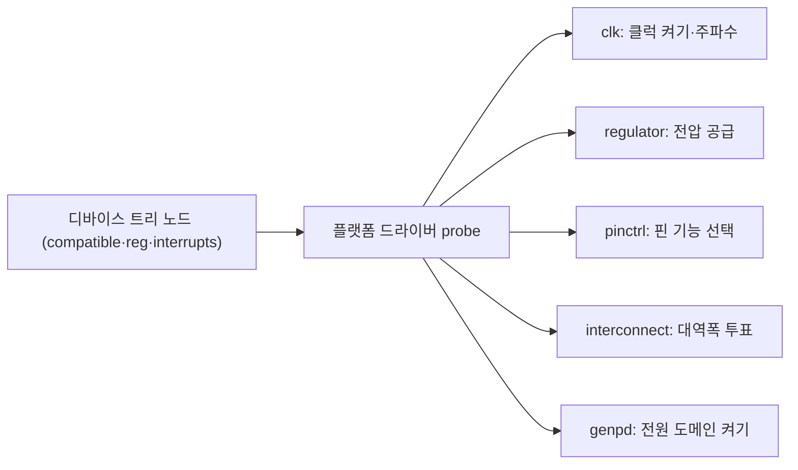

# Linux 커널과 SoC 지원

!!! spec "규격 · 세대"
    **Devicetree Specification**(devicetree.org) · 바인딩 문서 `Documentation/devicetree/bindings/`(YAML 스키마, `make dt_binding_check`) · arm64는 처음부터 디바이스 트리(또는 서버용 ACPI)로 하드웨어를 기술
    커널 프레임워크: Common Clock Framework · regulator · pinctrl · genpd(전원 도메인) · OPP·cpufreq·devfreq · **interconnect**(Linux 5.1, Linaro 주도) · remoteproc·rpmsg · mailbox · SCMI(Arm System Control and Management Interface)
    Arm 칩 공통 빌드: `arch/arm64/configs/defconfig` 하나로 여러 벤더 SoC를 함께 지원

!!! basic "한눈에 보기"
    PC는 바이오스(펌웨어)가 "이 컴퓨터에 어떤 장치가 있는지" 표준 방식으로 알려 주지만, 스마트폰 SoC는 칩마다 블록 구성과 주소가 다릅니다. 그래서 Linux는 **디바이스 트리**라는 설명서를 따로 받습니다.

    1. **디바이스 트리** — "UART는 이 주소에, 이 인터럽트 번호로, 이 클럭을 써서 있다"고 적은 하드웨어 지도입니다.
    2. **드라이버** — 지도에 적힌 장치를 찾아 실제로 동작시키는 코드입니다.
    3. **프레임워크** — 클럭·전원·핀처럼 모든 드라이버가 공통으로 쓰는 자원을 관리하는 공용 창구입니다.

    **업스트림(upstream)**은 공식 Linux 커널에 코드가 들어간 상태, **다운스트림(downstream)**은 벤더가 자기 저장소에서만 유지하는 커널입니다. 업스트림에 들어간 칩은 몇 년 뒤에도 최신 커널을 쓸 수 있지만, 다운스트림에만 있는 칩은 벤더가 손을 떼면 그 커널 버전에 묶입니다.

## 디바이스 트리와 SoC 기술 { .l2 }

디바이스 트리는 보통 **SoC 공통 파일**(`.dtsi`)과 **보드 파일**(`.dts`)로 나뉩니다. SoC 벤더가 칩 내부 블록을 `.dtsi`에 적고, 보드 제조사는 이를 포함한 뒤 어떤 블록을 켤지(`status = "okay"`), 어떤 레귤레이터·센서가 연결되었는지를 `.dts`에 씁니다. 컴파일된 바이너리(DTB)는 부트로더가 커널에 넘깁니다. arm64 소스는 `arch/arm64/boot/dts/<벤더>/`(예: `qcom`, `mediatek`, `exynos`, `rockchip`, `freescale`, `broadcom`)에 모여 있습니다.

| 프레임워크 | 커널 위치 | 하는 일 |
|---|---|---|
| Common Clock Framework | `drivers/clk/` | PLL·분주기·게이트를 트리로 관리, `clk_set_rate()` |
| regulator | `drivers/regulator/` | PMIC 출력 전압·전류 제어, 여러 소비자의 요구 합산 |
| pinctrl·GPIO | `drivers/pinctrl/` | 핀 멀티플렉싱, 풀업·구동 세기 |
| genpd | `drivers/pmdomain/` (이전 `drivers/soc/` 등에 분산) | 전원 도메인 on/off, 런타임 PM과 연동 |
| interconnect | `drivers/interconnect/` | 블록별 대역폭·지연 요구를 모아 NoC·DRAM 클럭 결정 |
| remoteproc·rpmsg | `drivers/remoteproc/`, `drivers/rpmsg/` | DSP·모뎀 같은 보조 프로세서의 펌웨어 로드·시작·통신 |
| OPP·cpufreq·devfreq | `drivers/opp/`, `drivers/cpufreq/`, `drivers/devfreq/` | 주파수·전압 표와 DVFS 정책 |

## 업스트림과 다운스트림 { .l2 }

| 구분 | 다운스트림(벤더) 커널 | 메인라인 커널 |
|---|---|---|
| 기능 범위 | 출시 기기에 필요한 전부 (카메라·모뎀·GPU 포함) | 공개 리뷰를 통과한 드라이버만 |
| 커널 버전 | 출시 시점 버전에 고정되기 쉬움 | 계속 최신 |
| 코드 품질 기준 | 벤더 내부 기준 | 메인테이너 리뷰·바인딩 스키마 |
| 대표 사례 | 대부분의 상용 스마트폰 | Qualcomm 일부 플랫폼, Rockchip RK3588, NXP i.MX, Raspberry Pi 일부 |

업스트림 지원은 벤더와 커뮤니티의 노력에 따라 크게 다릅니다. Qualcomm은 Linaro와 함께 오래전부터 클럭·인터커넥트·remoteproc 드라이버를 업스트림했고, 최근 플랫폼은 발표 무렵 기본 디바이스 트리와 클럭 드라이버 패치를 제출하는 사례가 늘었습니다. Samsung Exynos는 일부 칩과 Google Tensor(gs101) 기본 지원이 들어갔고, MediaTek은 Chromebook용 칩을 중심으로 업스트림이 진행되었습니다. Apple Silicon은 Asahi Linux 프로젝트가 역공학으로 지원을 만들어 왔습니다. 다만 "업스트림 지원"이 부팅·UART·저장장치 수준인지, GPU·카메라·모뎀까지인지는 칩마다 다르므로 항목별로 확인해야 합니다.

??? expert "전문가 노트 — interconnect 투표, remoteproc 수명 주기, SCMI로의 이동, defconfig와 모듈"
    **interconnect 투표.** 디스플레이·카메라·GPU 같은 블록은 `icc_set_bw(path, avg, peak)`로 평균·피크 대역폭을 요청하고, 프로바이더 드라이버는 같은 노드를 지나는 요청을 합산해 NoC와 DRAM 클럭을 정합니다. Qualcomm 플랫폼에서는 이 합산 결과가 RPMh 같은 전원 관리 프로세서에 투표로 전달되어, 여러 서브시스템의 요구를 하드웨어가 최종 집계합니다. 디스플레이 언더런이나 카메라 프레임 드롭은 투표가 너무 낮을 때, 대기 전력 증가는 투표가 해제되지 않을 때 자주 나타납니다.

    **remoteproc 수명 주기.** 보조 프로세서는 `remoteproc` 드라이버가 펌웨어(`.mdt`·`.mbn`·ELF)를 메모리 영역에 올리고, TrustZone을 통해 서명 검증을 받은 뒤 시작합니다. 동작 중 통신은 rpmsg·GLINK·SMEM 같은 공유 메모리 채널로 하고, 보조 프로세서가 죽으면 서브시스템 재시작(SSR)으로 해당 블록만 다시 올립니다. 이 구조 덕분에 모뎀이 크래시해도 전체 시스템을 재부팅하지 않습니다.

    **SCMI로의 이동.** 최근 Arm SoC는 클럭·전압·전원 도메인·성능 단계를 Linux가 직접 레지스터로 만지지 않고, SCP 같은 제어 프로세서에 SCMI 메시지로 요청하는 방식이 늘었습니다. 커널 쪽 드라이버는 `drivers/firmware/arm_scmi/` 하나로 통일되고, 칩별 세부는 펌웨어로 숨겨집니다. 업스트림 관점에서는 드라이버가 단순해지는 대신, 실제 동작을 펌웨어 쪽에서 디버깅해야 하는 부담이 생깁니다.

    **defconfig와 모듈.** arm64 `defconfig`는 여러 벤더 SoC 드라이버를 대부분 모듈(`=m`)로 켜 두어, 하나의 커널 이미지가 여러 보드에서 부팅되도록 합니다. 부팅에 꼭 필요한 드라이버(인터럽트 컨트롤러, 기본 클럭, 직렬 콘솔, 저장장치)는 내장해야 루트 파일 시스템을 찾을 수 있습니다. Android GKI도 같은 발상으로, 공통 이미지와 벤더 모듈을 분리합니다([Android BSP 구조](android-bsp.md)).

## 칩셋 비교

| 항목 | Qualcomm | MediaTek | Samsung Exynos·Google Tensor | Apple |
|---|---|---|---|---|
| 메인라인 디바이스 트리 | 다수 플랫폼 (`qcom/`) | Chromebook·IoT 칩 중심 (`mediatek/`) | 일부 칩 (`exynos/`, gs101) | 커뮤니티(Asahi) 중심 (`apple/`) |
| 업스트림 주체 | Qualcomm·Linaro·커뮤니티 | MediaTek·Collabora·Google ChromeOS 팀 등 | Samsung·Linaro·커뮤니티 | Asahi Linux 커뮤니티 |
| 전원·클럭 제어 | RPMh·SCMI 등 제어 프로세서 투표 | 자체 방식 + 일부 SCMI | 자체 방식 | 자체 방식(역공학) |
| 상용 기기 커널 | 다운스트림 + GKI | 다운스트림 + GKI | 다운스트림 + GKI | Linux 해당 없음 |

> 세대별 SoC의 공정·코어 구성은 [칩셋 세대 인덱스](../reference/chipset-index.md)에 모읍니다.

## 관련 페이지
- [Android BSP 구조](android-bsp.md) — GKI와 벤더 모듈의 분리
- [DVFS와 전력 관리](../power/dvfs.md) — OPP·cpufreq·devfreq의 동작
- [파워 도메인과 게이팅](../power/power-domains.md) — genpd가 켜고 끄는 대상
- [버스와 인터커넥트](../basics/interconnect.md) — interconnect 프레임워크가 다루는 NoC
- [개발 보드로 실습](dev-boards.md) — 메인라인 커널을 직접 올려 볼 보드
