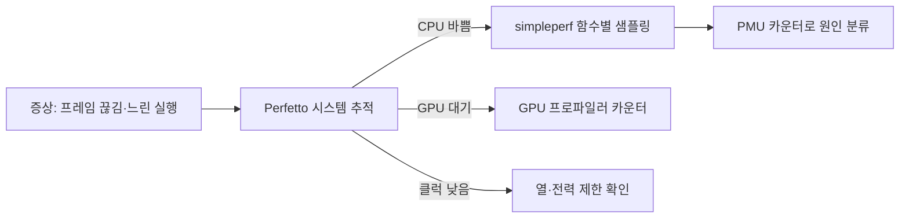

# 성능 분석 도구

!!! spec "규격 · 세대"
    Arm **PMUv3**(Performance Monitors Extension, Armv8-A부터; 이후 개정에서 이벤트·카운터 폭 확장) · **AMU**(Activity Monitors, Armv8.4-A) · **SPE**(Statistical Profiling Extension, Armv8.2-A) · CoreSight ETM·ETE 추적 · Linux `perf_events`
    Android: **Perfetto**(Android 9부터 시스템 추적 도구로 통합, 이후 기본 추적 도구) · **simpleperf**(NDK 포함) · **Android GPU Inspector**(지원 GPU·기기 한정) · 벤더 도구: Arm Streamline(Arm Performance Studio, 이전 이름 Arm Mobile Studio) · Snapdragon Profiler · Apple은 Xcode Instruments

!!! basic "한눈에 보기"
    "앱이 느리다"는 증상만으로는 원인을 알 수 없습니다. CPU가 바빠서인지, CPU가 놀고 있는데 GPU를 기다려서인지, 클럭이 열 때문에 낮아져서인지에 따라 해결책이 완전히 다릅니다.

    1. **시스템 추적(trace)** — 시간 축 위에 "어느 코어에서 어떤 스레드가 언제 돌았고, 클럭은 얼마였는지"를 모두 기록합니다. 전체 그림을 봅니다.
    2. **샘플링 프로파일링** — 일정 간격으로 "지금 어떤 함수를 실행 중인가"를 찍어, 시간을 많이 쓰는 함수를 찾습니다.
    3. **하드웨어 카운터** — CPU·GPU 안에 있는 계수기로 명령 수, 캐시 미스, 분기 예측 실패 같은 사건을 셉니다. "왜 느린지"를 봅니다.

    병원에 비유하면 시스템 추적은 하루 생활 기록, 샘플링은 엑스레이, 하드웨어 카운터는 혈액 검사입니다. 보통 이 순서로 범위를 좁혀 갑니다.

## 도구 지도 { .l2 }

| 도구 | 종류 | 주로 보는 것 | 비고 |
|---|---|---|---|
| Perfetto | 시스템 추적 | 스레드 스케줄링, CPU 주파수·idle 상태, 프레임 타임라인, 전력 레일, 메모리 | 웹 UI(ui.perfetto.dev)와 SQL 질의 |
| simpleperf | CPU 샘플링·카운터 | 함수별 시간, 콜 그래프, PMU 이벤트 | Linux `perf`의 Android 버전 |
| Arm Streamline | 시스템 + 카운터 | Arm CPU·Mali GPU 카운터를 같은 시간 축에 | Mali 기기에서 특히 강함 |
| Snapdragon Profiler | 벤더 프로파일러 | Adreno GPU·CPU·DSP 지표, 프레임 캡처 | Snapdragon 기기 |
| Android GPU Inspector | GPU 프로파일러 | Vulkan 프레임 분석, GPU 카운터 | 지원 GPU·드라이버 필요 |
| Xcode Instruments | 통합 프로파일러 | Apple 기기의 CPU·GPU·전력 | iOS·macOS |

먼저 Perfetto로 문제가 일어난 구간을 찾고, 그 구간에서 메인 스레드가 **실행 중(Running)**인지, **실행 대기(Runnable)**인지, **잠자는 중(Sleeping)**인지 봅니다. Runnable이 길면 코어 배치나 우선순위 문제, Sleeping이 길면 잠금·I/O·GPU를 기다리는 문제, Running인데 느리면 그때 코어 종류와 주파수를 확인한 뒤 함수 수준 분석으로 넘어갑니다.

## PMU 카운터와 Top-down 분석 { .l2 }

| 이벤트 (PMUv3 공통 이름) | 의미 | 읽는 법 |
|---|---|---|
| `CPU_CYCLES` | 코어 사이클 | 분모 |
| `INST_RETIRED` | 완료된 명령 수 | IPC = 명령 수 ÷ 사이클 |
| `STALL_FRONTEND` | 명령 공급이 부족해 멈춘 사이클 | 명령 캐시·분기 예측 문제 |
| `STALL_BACKEND` | 실행 자원·데이터를 기다려 멈춘 사이클 | 데이터 캐시 미스·DRAM 지연 |
| `L1D_CACHE_REFILL`, `L2D_CACHE_REFILL` | 캐시 미스로 채운 횟수 | 1000명령당 미스(MPKI)로 비교 |
| `BR_MIS_PRED` | 분기 예측 실패 | 분기 많은 코드의 손실 |

가상의 예로 어떤 구간에서 명령 30억 개를 사이클 20억 번에 완료했다면 IPC는 1.5입니다. (가정값이며, 수치는 `tools/soc_numbers.py`에서 계산) IPC 하나만으로는 원인을 알 수 없으므로, **Top-down 분석**은 코어의 명령 처리 슬롯을 "유효하게 완료(Retiring)", "잘못된 추측으로 버림(Bad speculation)", "프런트엔드 부족(Frontend bound)", "백엔드 부족(Backend bound)"으로 나눠 가장 큰 항목부터 파고듭니다. Intel이 체계화한 방법이며, Arm도 Neoverse·최근 Cortex 코어용 Top-down 가이드와 도구를 공개했습니다.

??? expert "전문가 노트 — 카운터 다중화, 이기종 코어의 함정, 추적 오버헤드, GPU 카운터 해석"
    **카운터 다중화.** 코어마다 프로그래밍 가능한 PMU 카운터는 수가 제한되어 있습니다(구현마다 다르며 보통 6개 안팎). 그보다 많은 이벤트를 요청하면 `perf`가 시간 분할로 돌려 가며 세고 값을 비례 추정하므로, 짧은 구간이나 위상이 자주 바뀌는 코드에서는 오차가 커집니다. 서로 나눠야 하는 이벤트(예: 미스와 명령 수)는 같은 그룹으로 묶어 동시에 세야 비율이 의미가 있습니다.

    **이기종 코어의 함정.** 큰 코어와 작은 코어는 PMU 구현과 지원 이벤트가 다를 수 있고, 같은 이름의 이벤트라도 정의가 미묘하게 다릅니다. 스레드가 측정 중에 클러스터를 옮겨 다니면 합산 결과가 섞이므로, 분석할 때는 `taskset`으로 코어를 고정하거나 Perfetto에서 코어 종류별로 나눠 봐야 합니다. 주파수가 바뀌는 동안의 사이클 수는 시간과 비례하지 않는다는 점도 주의해야 합니다([스케줄링과 EAS](../cpu/scheduling.md)).

    **추적 오버헤드.** 시스템 추적은 이벤트가 많을수록 버퍼와 CPU를 씁니다. 모든 sched·irq 이벤트에 높은 빈도의 콜스택 샘플링까지 켜면, 측정 자체가 스케줄링과 캐시 상태를 바꿉니다. 처음에는 넓고 가벼운 설정으로 문제 구간을 찾고, 그 구간만 무거운 설정으로 다시 재는 것이 좋습니다. 전력 측정을 함께 할 때는 추적 도구의 전력도 결과에 섞인다는 점을 기록해 둡니다([전력 측정과 분석](../power/measurement.md)).

    **GPU 카운터 해석.** GPU 카운터는 벤더마다 이름과 구조가 달라 서로 직접 비교하기 어렵습니다. 공통으로 보는 것은 GPU 활성 사이클, 셰이더 코어 활용률, 텍스처·메모리 대역폭, 타일 처리 단계별 부하입니다. 타일 기반 GPU에서는 외부 메모리 읽기·쓰기량이 전력과 직결되므로, 프레임당 DRAM 트래픽이 갑자기 늘었다면 렌더 패스 구성이나 압축 포맷을 먼저 의심합니다([모바일 GPU 구조](../gpu/architecture.md)).

## 칩셋 비교

| 항목 | Qualcomm | MediaTek | Samsung Exynos·Google Tensor | Apple |
|---|---|---|---|---|
| CPU 카운터 접근 | simpleperf·Perfetto (Arm PMU) | simpleperf·Perfetto (Arm PMU) | simpleperf·Perfetto (Arm PMU) | Instruments (자체 코어 카운터) |
| GPU 프로파일러 | Snapdragon Profiler, AGI | Arm Streamline·Performance Studio(Mali 계열), AGI | GPU 공급사 도구 (세대별 GPU 계열에 따름), AGI | Xcode GPU 도구 |
| NPU 분석 | QNN 프로파일링 도구 | NeuroPilot 도구 | 벤더 SDK 도구 | Core ML 성능 리포트 |
| 공개 정도 | 공개 다운로드 | 일부 개발자 등록 필요 | 제한적 | Xcode에 포함 |

## 관련 페이지
- [스케줄링과 EAS](../cpu/scheduling.md) — 추적에서 보는 스레드 배치의 원리
- [코어 마이크로아키텍처](../cpu/microarchitecture.md) — 프런트엔드·백엔드 정체의 원인
- [전력 측정과 분석](../power/measurement.md) — 전력 레일과 추적을 함께 보는 법
- [벤치마크 읽는 법](benchmarks.md) — 측정 결과를 비교할 때의 조건
- [모바일 GPU 구조](../gpu/architecture.md) — GPU 카운터가 가리키는 블록
